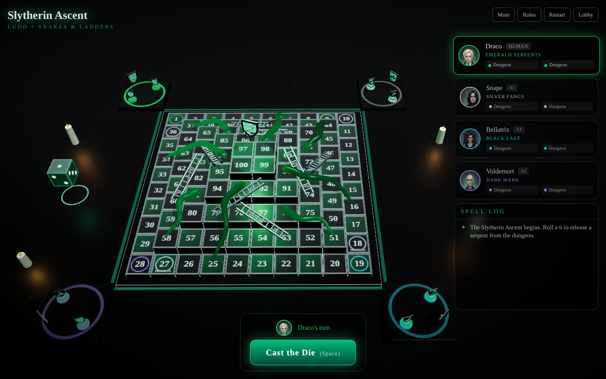

# Slytherin Ascent — Ludo × Snakes & Ladders (3D)

Next.js 16 (App Router) · React 19 · React Three Fiber 9 · drei 10 · Three.js 0.187 · Tailwind CSS 4.



## Run / deploy

```bash
npm install
npm run dev      # http://localhost:3000
npm test         # rules + board self-check (8 tests, incl. 200 simulated AI games)
npm run build    # production build
```

Vercel: push the folder to a Git repo and import it, or run `npx vercel` in this folder. No env vars, no API routes, no external assets (SFX are synthesized, environment lighting is local). Only the Google Fonts stylesheet is fetched at runtime.

## Play together

- **Same Device**: 2–4 seats, each Human or AI. Pass the phone/tablet around.
- **Online** (two devices, e.g. Android/PC + iPhone/iPad):
  1. One player taps **Online → Create room**. A 4-letter code appears.
  2. Tap **Share link** and send it to your partner, or tell them the code.
  3. The partner opens the link (or **Online → Join** with the code).
  4. The host marks the partner's seat as **Partner** and taps **Begin the Ascent**.

  The host's device runs the game and the AI; the partner's device mirrors it and can only act on its own turn. If a phone sleeps, open the link again to rejoin mid-game.

  Connection is peer-to-peer (WebRTC via [PeerJS](https://peerjs.com)); no account or server setup. It uses the free public PeerJS broker. To self-host it, run a [`peer`](https://github.com/peers/peerjs-server) server and set `NEXT_PUBLIC_PEER_HOST`, `NEXT_PUBLIC_PEER_PORT`, `NEXT_PUBLIC_PEER_PATH` (and `NEXT_PUBLIC_PEER_SECURE=false` for plain HTTP) in Vercel.

Tips for phones: turn off the iPhone silent switch to hear sound effects; keep the host's screen on during online games.

## How the hybrid works

The 100 tiles form a **ziggurat** of 5 concentric rings; each inner ring is one layer higher (the "4D height factor").

| Ring | Tiles | Progress | Phase |
|------|-------|----------|-------|
| 0 (outer 10×10) | 36 | 1–36 | Ludo lap: captures, Protego safe tiles |
| 1 (8×8) | 28 | 37–64 | Ascent: snakes & ladders |
| 2 (6×6) | 20 | 65–84 | 〃 |
| 3 (4×4) | 12 | 85–96 | 〃 |
| 4 (2×2 summit) | 4 | 97–100 | Exact roll to finish |

- Each seat starts on its own corner. Seat *q*'s path is seat 0's path rotated *q*×90°, so all four courses are identical.
- Snakes/ladders are defined once and replicated ×4 by rotation. Every jump crosses rings, so ladders always boost and snakes always drop, for every seat (asserted in `lib/rules.test.ts`).
- Ludo rules: a 6 releases a token. Landing on a rival outside a Protego tile sends it home. A 6, a capture or a finish gives another roll. Three 6s in a row forfeit the turn. First player with both tokens on the summit wins.
- Tile numbers show seat 0's spiral ("runes"). Other seats walk the same numbers rotated.

## Structure

```
app/                 layout, page, Tailwind theme (globals.css)
components/
  Game.tsx           client root: wires hooks → Scene + HUD, keyboard (Space, 1/2)
  GameLoader.tsx     dynamic import, ssr:false (WebGL is browser-only)
  scene/             R3F: Scene, Board (tiles, bases, summit), Jumps (serpents, silver ladders),
                     Token (waypoint animation + spell trail), CrystalDie, Crest, BloomEffect
  ui/                SetupScreen (lobby), Hud (roster, action bar, log, rules, victory)
hooks/
  useGameEngine.ts   turn state machine: roll → choose → animate → commit → next turn; AI timing
  useOnline.ts       PeerJS room: create/join by code, reconnect, message validation
  useSfx.ts          Web Audio spell SFX (dice, step, ladder chime, Parseltongue hiss, Expulso boom…)
lib/
  board.ts           pure geometry: rings, paths, jumps, safe tiles, world positions
  rules.ts           pure rules: legal moves, resolve move, captures, AI, log narration
  net.ts             online protocol (host snapshots ⇄ guest intents), seat ownership
  geometry.ts        Three.js curves shared by meshes and token slide/climb animations
  theme.ts           seat colours, character roster (portraits in public/characters)
```

SFX trigger points are marked `// SFX TRIGGER:` in `hooks/useGameEngine.ts`. To use recorded audio, replace a recipe in `hooks/useSfx.ts` with `new Audio('/sfx/x.mp3').play()`.

Bloom is skipped on software renderers (SwiftShader/llvmpipe), where the bloom pass renders black.
